# Favo

Jogo de estratégia com insetos, inspirado no jogo de tabuleiro Hive (de John Yianni, publicado pela Gen42 Games; este é um projeto independente, sem afiliação). Regras oficiais (jogo base + Mosquito, Joaninha e Tatuzinho), para jogar com amigos **hospedando no seu próprio PC**, sem servidor na nuvem, ou contra o computador.

## Para jogar

### Instalar
Baixe o `Favo-Setup.exe` nas [Releases](https://github.com/nacaratti/hive-game/releases/latest) e rode. Na primeira vez, o Windows pergunta se o Favo pode usar a rede: permita em **redes privadas**. Sem isso, seus amigos não conseguem se conectar.

### Hospedar uma partida
1. Abra o Favo, digite seu nome e clique em **Entrar no salão**. O seu PC já é o servidor.
2. Clique em **Criar sala** e escolha as expansões e o relógio.
3. Chame os amigos:
   - **Mesma rede (Wi-Fi ou cabo):** quem tem o Favo vê seu servidor na lista "Entrar no servidor de um amigo". Quem não tem abre no navegador ou no celular o endereço `http://192.168.x.x:4242` que aparece em "Chamar amigos" (ou lê o QR code).
   - **Pela internet:** clique em **Compartilhar pela internet**. O Favo abre um túnel gratuito da Cloudflare e mostra um link `https://….trycloudflare.com`. Envie o link: funciona sem configurar o roteador, mesmo com CGNAT. Na primeira vez, ele oferece baixar o programa oficial `cloudflared` (cerca de 60 MB). O link vale enquanto o Favo estiver aberto. Coloque senha na sala.
4. Com os dois lugares ocupados, clique em **Iniciar partida**.

Você também pode colocar o **computador** num lugar vazio da sala (fácil, médio ou difícil).

### Entrar na partida de um amigo
- Com o Favo: escolha o servidor na lista da rede local, ou cole o endereço/link que ele enviou em "Entrar no servidor de um amigo".
- Sem instalar nada: abra o link no navegador.

### Jogar sozinho
**Jogar contra o computador** (tela inicial ou salão) roda o robô no seu PC, sem internet.

<!-- regras:inicio -->
## Como jogar

Nos desenhos, a peça com contorno claro é a que se move e os hexágonos dourados mostram para onde ela pode ir. As posições foram calculadas pelo próprio motor de regras. Dentro do jogo, o botão **Como jogar** no canto do tabuleiro mostra o mesmo guia.

### Como cada peça anda

| Exemplo | Peça | Como anda |
|:-:|---|---|
| 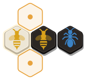 |  **Abelha-Rainha** | Anda uma casa por vez, deslizando. |
| 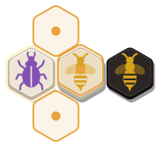 | 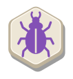 **Besouro** | Anda uma casa, mas pode subir em cima de outras peças e andar por cima da colmeia. A peça coberta fica presa até o besouro sair. |
|  | 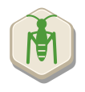 **Gafanhoto** | Pula em linha reta por cima de uma ou mais peças até a primeira casa vazia. Como não desliza, passa por aberturas estreitas. |
| 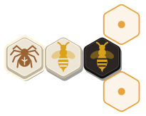 |  **Aranha** | Anda exatamente três casas, deslizando em volta da colmeia, sem voltar pelo caminho. |
| 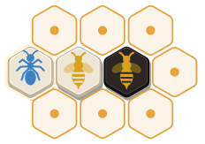 | 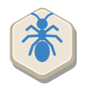 **Formiga** | Desliza quantas casas quiser em volta da colmeia. Só não entra em buracos fechados. |
|  | 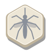 **Mosquito** _(expansão)_ | Copia o movimento de qualquer peça que esteja encostando nele. Aqui, ao lado do gafanhoto, ele pula. Em cima da colmeia, anda como besouro. |
| 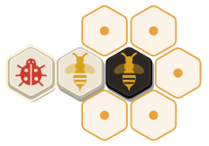 |  **Joaninha** _(expansão)_ | Anda três casas: duas por cima da colmeia e a última descendo para uma casa vazia. |
| 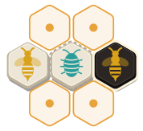 | 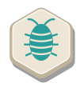 **Tatuzinho** _(expansão)_ | Anda como a rainha. Ou, em vez de andar, levanta uma peça vizinha de qualquer cor e a coloca em outra casa vazia ao seu lado. Não pode pegar a peça que o adversário acabou de mover. |

### Regras básicas

| Exemplo | Regra | |
|:-:|---|---|
| 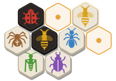 | **Objetivo** | Cerque a Abelha-Rainha do adversário pelos seis lados, com peças de qualquer cor. Se as duas rainhas ficarem cercadas no mesmo lance, é empate. |
| 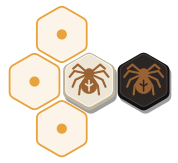 | **Colocar peças** | Na sua vez, coloque uma peça nova ou mova uma que já está no jogo. Peças novas só podem encostar nas suas, nunca nas do adversário. Só a primeira peça de cada um foge a essa regra. |
|  | **A Abelha-Rainha** | Ela precisa entrar no jogo até o seu 4º turno, e nenhuma peça sua pode se mover antes disso. No primeiro turno ela não pode ser colocada (regra de torneio). |
| 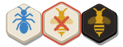 | **Uma colmeia só** | As peças precisam formar sempre um único grupo. Uma peça não pode sair se isso dividir a colmeia em duas, nem por um instante. |
| 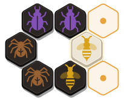 | **Deslizar** | Quem anda pelo chão desliza: não passa por uma abertura estreita entre duas peças e nunca se afasta da colmeia. Aqui a rainha não consegue entrar no buraco. |
|  | **Sem lance possível** | Se você não tiver nenhuma peça para colocar nem para mover, passa a vez. |
<!-- regras:fim -->

## Como foi construído

```
packages/engine    Regras do jogo (TypeScript puro, sem dependências). Fonte única da verdade.
packages/protocol  Mensagens cliente↔servidor validadas com zod.
packages/ai        Robô: busca alpha-beta + avaliação com pesos treináveis (models/current.json).
apps/server        Servidor autoritativo (Fastify + Socket.IO), salas, relógio, reconexão, descoberta na LAN.
apps/client        Interface (React 19 + Vite + Tailwind 4).
apps/desktop       App Electron: servidor embutido, LAN, túnel Cloudflare, instalador.
apps/mobile        App Android (Capacitor) que empacota apps/client. iOS depois.
apps/site          Página de download (estática, para a Vercel).
```

O servidor valida todo lance com o motor de regras; o cliente envia só o lance (`wS1 -bQ`, notação UHP), nunca o tabuleiro. Toda partida terminada é gravada em `games.jsonl` (no app instalado: `%APPDATA%\Favo\data`).

## Desenvolvimento

Requer Node 20+. Na pasta `hive-pro/`:

```bash
npm install
```

```bash
npm run dev
```
Gera o cliente e sobe o servidor em http://localhost:4242 (abra em duas abas, ou numa aba normal e outra anônima, para testar dois jogadores).

```bash
npm run dev:client
```
Interface com recarga instantânea em http://localhost:5173 (use junto com `npm run dev:server`).

```bash
npm test
```
Testes de regras, perft (confere com os valores de referência do Mzinga até a profundidade 6), fuzz de milhares de partidas aleatórias, servidor e robô.

```bash
npm run desktop
```
Abre o app Electron em modo de desenvolvimento.

```bash
npm run dist
```
Gera o instalador em `apps/desktop/release/`.

## Versão para navegador (Vercel)

Fica em `/jogar` na página de download. Não usa servidor: o robô roda no navegador, e a partida contra um amigo é uma conexão direta entre os dois navegadores (WebRTC). Quem cria a partida guarda o jogo e confere os lances; o serviço gratuito do PeerJS só apresenta os dois navegadores. Em algumas redes (principalmente 4G) a conexão direta pode não fechar.

```bash
npm run build-web -w @hive/site
```
Gera a versão em `apps/site/public/jogar/`. A Vercel publica a página e o jogo sozinha a cada push na `main` do GitHub, usando o `vercel.json` da raiz (instalação completa, `build-web` e a pasta `apps/site/public`).

## Publicar uma nova versão do instalador

O instalador fica nas [Releases do GitHub](https://github.com/nacaratti/hive-game/releases), e o botão do site aponta para `https://github.com/nacaratti/hive-game/releases/latest/download/Favo-Setup.exe`, que sempre entrega a versão mais recente. Depois de subir a versão em `apps/desktop/package.json` e rodar `npm run dist`:

```bash
cp "apps/desktop/release/Favo Setup 0.2.0.exe" Favo-Setup.exe
```
```bash
gh release create v0.2.0 Favo-Setup.exe --title "Favo 0.2.0"
```
O arquivo precisa se chamar exatamente `Favo-Setup.exe` para o link do site continuar funcionando (o sufixo `#nome` do `gh` muda só o rótulo, não o nome do arquivo).

## App Android

O celular entra em partidas hospedadas por um PC (endereço, QR code ou link) e joga offline contra o computador ou com duas pessoas. Ele não hospeda.

Requer o Android Studio instalado (traz o Java e o Android SDK). Com o celular ligado por USB e a depuração USB ativada:

```bash
npm run run:android -w @hive/mobile
```
Gera o cliente, copia para o projeto Android e instala no celular. Para abrir o projeto no Android Studio, use `npm run android -w @hive/mobile`.

Para testar o fluxo do app no navegador, sem celular: abra `http://localhost:5173/?mobile` com `npm run dev:client` e `npm run dev:server` rodando.

## Treinar o robô

O robô avalia posições com pesos guardados em `packages/ai/models/current.json`. Dois modos de treino, ambos rodando no seu PC:

```bash
npm run train -- selfplay --iterations 30 --games 8
```
Autojogo: o robô enfrenta cópias levemente modificadas de si mesmo e mantém as mudanças que vencem mais.

```bash
npm run train -- games --file data/games.jsonl
```
Aprende com partidas reais gravadas pelo servidor: ajusta a avaliação para prever quem venceu.

No fim, os pesos novos enfrentam os anteriores; só substituem `current.json` se não jogarem pior (`--force` ignora essa trava). Depois, rode `npm run dist` para o instalador levar o robô novo.

Para comparar níveis ou pesos:

```bash
npm run arena -- medio dificil 10
```
